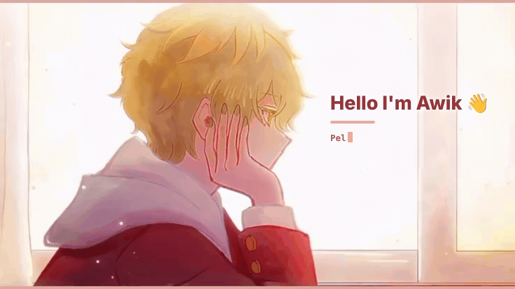
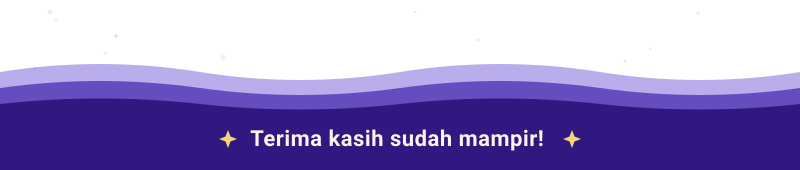

  

## 🌸 Tentang Aku

Halo! Aku **Awik**, nama lengkapku **Muhammad Fawaidul Aisyi**, dari Indonesia 🇮🇩

- 🎓 Masih pelajar dan terus berkembang
- 📚 Sedang belajar **React Native** dan **Go**
- 🎮 Suka main game
- 🏐 Kadang main voli
- 🎌 Suka anime untuk hiburan
- 🔭 Proyek-proyekku bisa kamu lihat langsung di [repositoriku](https://github.com/RedBlue-awik?tab=repositories)

## ⚔️ Status Window

  

## 📊 Bahasa yang Sering Kupakai

 

## 🎮 Aktivitas Kontribusi

<picture>
  <source media="(prefers-color-scheme: dark)" srcset="https://raw.githubusercontent.com/RedBlue-awik/RedBlue-awik/output/pacman-contribution-graph-dark.svg">
  <source media="(prefers-color-scheme: light)" srcset="https://raw.githubusercontent.com/RedBlue-awik/RedBlue-awik/output/pacman-contribution-graph.svg">
  
</picture>

