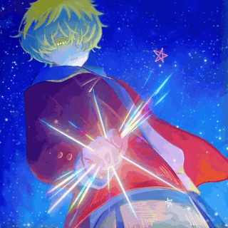

  

<h1 align="center">Hello I'm Awik 👋</h1>

  

## 🌸 Tentang Aku

Halo! Aku **Awik**, nama lengkapku **Muhammad Fawaidul Aisyi**, dari Indonesia 🇮🇩

- 🎓 Masih pelajar dan terus berkembang
- 📚 Sedang belajar **React Native** dan **Go**
- 🎮 Suka main game
- 🏐 Kadang main voli
- 🎌 Memang suka anime
- 🔭 Proyek-proyekku bisa kamu lihat langsung di [repositoriku](https://github.com/RedBlue-awik?tab=repositories)

 

## ⚔️ Status Window

  

## 🌟 Anime Favoritku

**[Mikadono Sanshimai wa Angai, Choroi](https://myanimelist.net/anime/59207/Mikadono_Sanshimai_wa_Angai_Choroi)** (*Dealing with Mikadono Sisters Is a Breeze*)

- 🧠 **Mikadono Miwa**: karakter yang jenius, aku suka kecerdasannya
- 💛 **Ayase Yuu**: karakter yang baik hati

## 📊 Bahasa yang Sering Kupakai

## 🎮 Aktivitas Kontribusi

<picture>
  <source media="(prefers-color-scheme: dark)" srcset="https://raw.githubusercontent.com/RedBlue-awik/RedBlue-awik/output/pacman-contribution-graph-dark.svg">
  <source media="(prefers-color-scheme: light)" srcset="https://raw.githubusercontent.com/RedBlue-awik/RedBlue-awik/output/pacman-contribution-graph.svg">
  
</picture>

  Terima kasih sudah mampir! 🌷

